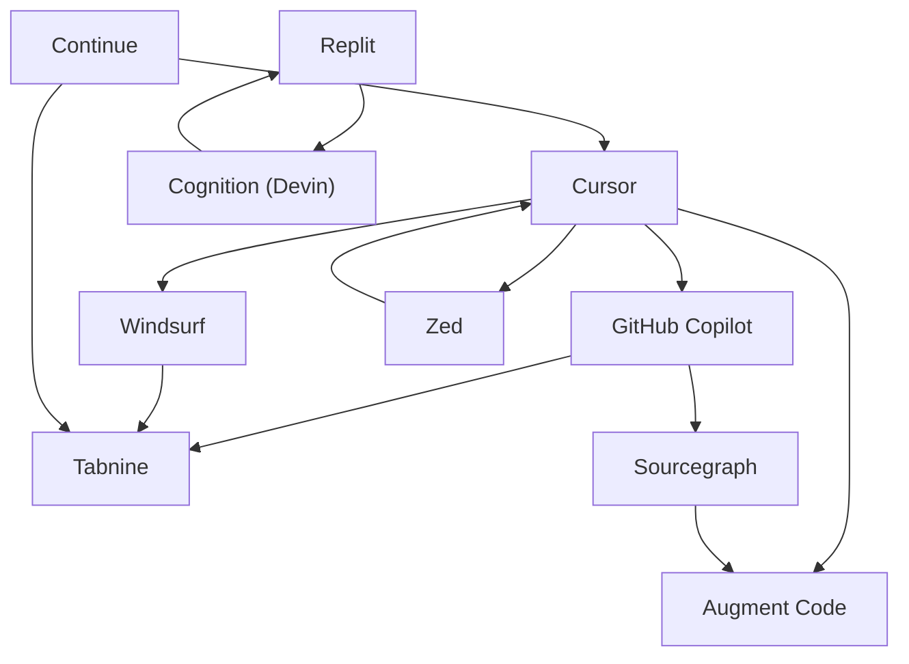

# Market Map Builder

Point it at a tech sector (e.g. `"AI code review tools"`) and it researches the
competitive landscape with Claude's web search, then writes an **Obsidian vault**
where every competitor is its own markdown note, auto-linked to its rivals via
`[[wikilinks]]`. Each sector also gets a hub note with a summary table, a
Claude-written landscape paragraph, and a Mermaid relationship graph — so you can
open the folder in Obsidian and literally *see* the market.

No Obsidian plugins, no database — the folder of markdown files **is** the
database.

---

## Demo


> 📹 **Placeholder** — record a short terminal + Obsidian graph-view clip and drop
> it in as `docs/demo.gif` (see [`docs/README.md`](docs/README.md)).

A ready-to-open example vault is committed at
[`vault/ai-coding-assistants/`](vault/ai-coding-assistants/) — clone the repo and
open that folder in Obsidian to see the graph immediately, no API key required.
It was generated with the offline sample dataset (`--mock`); a live run produces
freshly researched data. Here's the relationship graph it produces (GitHub
renders it inline):



---

## Why this exists

VCs and market analysts spend hours doing the same sourcing motion: pick a space,
find who's in it, note stage / funding / differentiator, and map who competes with
whom. This automates the first pass into a **navigable knowledge graph** you can
extend by hand — every note is plain markdown, every relationship is a real link,
and `refresh` keeps a timestamped changelog as the market moves. It's a starting
point for diligence, not a substitute for it: the tool marks anything it can't
verify as `unknown` rather than guessing.

---

## Features

- 🔎 **Real research, not scraping** — Claude + the `web_search` server tool.
- 🔗 **Interlinked notes** — `[[wikilinks]]` between direct competitors, verified
  so every link resolves.
- 🧭 **Hub note per sector** — table, landscape summary, and Mermaid graph.
- ♻️ **Refresh mode** — re-run a sector; changed notes get a `## Changelog` entry,
  new companies get added, nothing is duplicated.
- 🆓 **Free offline mode** — `--mock` builds a full vault with sample data (no key,
  no cost) so you can try the whole pipeline instantly.
- 🔒 **Secure by design** — the API key lives only in `src/research.py`, read from
  the environment, never printed, logged, or written into the vault.
- 🚫 **No fabrication** — unverifiable funding/dates are left `unknown` /
  `undisclosed`.

---

## Setup

Requires Python 3.9+ (works on 3.11+ too).

```bash
# 1. Install dependencies (a virtualenv is recommended)
python3 -m venv .venv && source .venv/bin/activate
pip install -r requirements.txt

# 2. Add your Anthropic API key (only needed for LIVE research)
cp .env.example .env
# then edit .env and set ANTHROPIC_API_KEY=sk-ant-...
```

You can skip step 2 entirely and use `--mock` for free offline runs.

---

## Usage

```bash
# Build a fresh market map (live research)
python -m src.main map "AI code review tools"

# More companies, custom output directory
python -m src.main map "AI code review tools" --num-companies 15
python -m src.main map "AI code review tools" --vault-path ./my-vault

# Free offline sample data — no key, no cost
python -m src.main map "AI coding assistants" --mock

# Re-research an existing sector and diff the changes into the vault
python -m src.main refresh "AI code review tools"
```

Open the resulting `vault/<sector>/` folder in Obsidian and switch to **graph
view** to explore the landscape.

### Invoke as a Claude Code skill

The repo ships a skill at [`.claude/skills/market-map/`](.claude/skills/market-map/SKILL.md).
In Claude Code you can just say *"map the market for vector databases"* /
*"build a competitive landscape for AI voice agents"* and it runs the CLI for you.

---

## How it works

1. **Discover + research** (1 web-search call) — Claude finds 8–15 real, active
   companies in the sector and gathers stage, funding, differentiator, customer,
   competitors, and sources, citing what it verifies.
2. **Extract** (1 structured call) — that dossier is converted to strict JSON and
   validated into typed [`Company`](src/models.py) models. Anything missing stays
   `unknown` / `undisclosed`; malformed entries are dropped, not guessed.
3. **Write** — each company becomes a note; a hub note gets the table, a
   Claude-written landscape summary, and the Mermaid graph. Every `[[wikilink]]`
   is verified against the files on disk.

## Output structure

```
vault/
└── ai-coding-assistants/
    ├── _ai-coding-assistants-map.md   ← hub: table + summary + graph
    ├── cursor.md
    ├── github-copilot.md
    └── … one note per company
```

Each company note carries YAML frontmatter (`company`, `sector`,
`funding_stage`, `founded`, `tags`), a description, a details block, its
differentiator, `[[wikilinks]]` to related companies, and its sources.

---

## Security & self-hosting

Security was a first-class requirement here. What the tool guarantees out of the
box:

- **The key never leaves `src/research.py`.** It's read from the environment
  (loaded from `.env` by `python-dotenv`), never passed as an argument, never
  printed, never logged, and never written into the vault.
- **`.gitignore` protects secrets** — `.env`, `*.key`, `*.pem`, and
  `vault/private/` are ignored. Only `.env.example` (a placeholder) is committed.
- **Input is validated before any API call** — sector/company strings are
  stripped, length-limited (2–80 chars), and restricted to a safe character set,
  which also blocks junk / injection-style input.
- **The client never needs your key** — this is a local CLI; the key is only ever
  used server-side by the process you run.

If you **host this** (e.g. behind a web endpoint or a bot), harden it further:

1. **Keep the key server-side only.** The server holds one `ANTHROPIC_API_KEY`;
   never accept a key from users and never return it in any response.
2. **Put auth + rate limiting in front.** The CLI has no network listener of its
   own — whatever wraps it must authenticate callers and cap request rate to
   prevent someone burning your API budget.
3. **Set spend caps and use a dedicated, rotatable key** (ideally a
   workspace-scoped key) in the Anthropic Console, so a leak is contained and
   cheap to revoke.
4. **Run least-privilege** — non-root, a minimal container, and a read-only
   filesystem except for the vault output directory.
5. **Don't log request bodies with secrets.** This tool doesn't log the key; keep
   it that way in any wrapper you add.
6. **Keep private research out of git** — put sensitive maps under
   `vault/private/` (already git-ignored).
7. **Rotate the key** if it's ever exposed, and audit usage in the Console.

---

## Tests

Offline, no key required:

```bash
python -m tests.test_vault_links     # every [[wikilink]] resolves to a note
python -m tests.test_refresh         # diff / changelog / add / idempotency
# or, with pytest installed:  pytest -q
```

---

## Project structure

```
.
├── src/
│   ├── main.py          # CLI entrypoint (Typer)
│   ├── research.py      # Claude + web search — the ONLY module with the key
│   ├── vault_writer.py  # markdown notes + wikilinks + hub + graph
│   ├── models.py        # Pydantic models + slugify + validation
│   └── refresh.py       # diff an existing sector, append changelogs
├── tests/               # offline link-integrity + refresh tests
├── vault/               # generated vaults (example committed)
├── .claude/skills/market-map/SKILL.md
├── docs/                # demo.gif goes here
├── .env.example
└── requirements.txt
```
