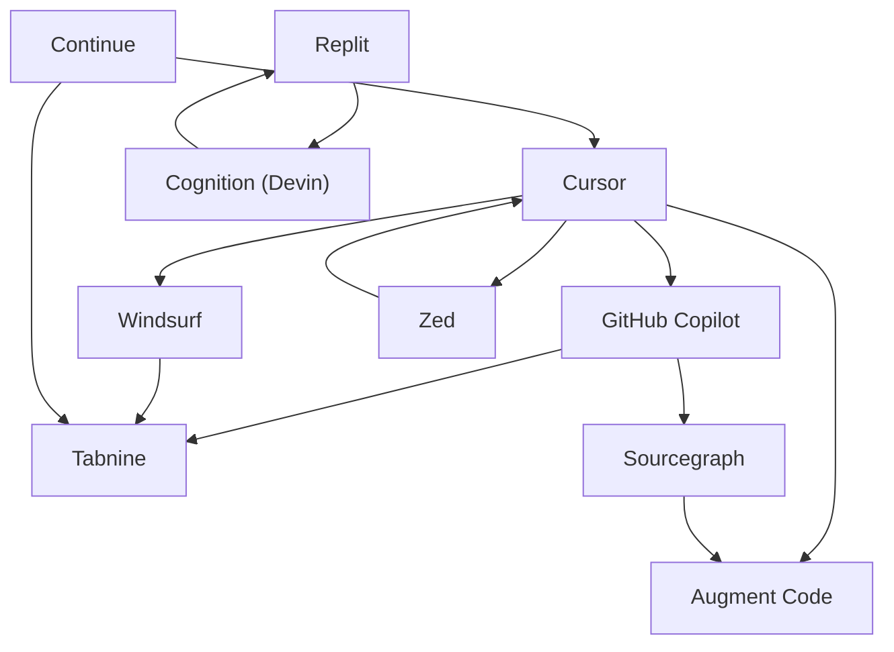

# Market Map Builder

Point it at a tech sector (e.g. `"AI code review tools"`) and it researches the
competitive landscape with Claude's web search, then writes an **Obsidian vault**
where every competitor is its own markdown note, auto-linked to its rivals via
`[[wikilinks]]`. Each sector also gets a hub note with a summary table, a
Claude-written landscape paragraph, and a Mermaid relationship graph — so you can
open the folder in Obsidian and literally *see* the market.

No Obsidian plugins, no database — the folder of markdown files **is** the
database.

---

## Demo


> 📹 **Placeholder** — record a short terminal + Obsidian graph-view clip and drop
> it in as `docs/demo.gif` (see [`docs/README.md`](docs/README.md)).

A ready-to-open example vault is committed at
[`vault/ai-coding-assistants/`](vault/ai-coding-assistants/) — clone the repo and
open that folder in Obsidian to see the graph immediately, no API key required.
It was generated with the offline sample dataset (`--mock`); a live run produces
freshly researched data. Here's the relationship graph it produces (GitHub
renders it inline):



---

## Why this exists

VCs and market analysts spend hours doing the same sourcing motion: pick a space,
find who's in it, note stage / funding / differentiator, and map who competes with
whom. This automates the first pass into a **navigable knowledge graph** you can
extend by hand — every note is plain markdown, every relationship is a real link,
and `refresh` keeps a timestamped changelog as the market moves. It's a starting
point for diligence, not a substitute for it: the tool marks anything it can't
verify as `unknown` rather than guessing.

---

## Features

- 🔎 **Real research, not scraping** — Claude + the `web_search` server tool.
- 🔗 **Interlinked notes** — `[[wikilinks]]` between direct competitors, verified
  so every link resolves.
- 🧭 **Hub note per sector** — table, landscape summary, and Mermaid graph.
- ♻️ **Refresh mode** — re-run a sector; changed notes get a `## Changelog` entry,
  new companies get added, nothing is duplicated.
- 🧾 **Deal-memo depth** — last round, lead investors, headcount, HQ, business
  model, customers, founders (public info only) on every note.
- 📎 **Per-fact provenance** — each figure cites its source URL, and every note
  carries a `last_verified` date surfaced in the hub table.
- 📰 **Change digests** — `digest` / `watchlist run` turn refreshes into a
  "what moved this week" note, cron-friendly, with optional Slack delivery.
- 📤 **Exports** — one command to CSV (Airtable/Sheets-ready) or JSON, straight
  from the vault, offline.
- 📝 **Draft deal memos** — `memo` writes a grounded first-pass memo where every
  unknown becomes an explicit diligence question, never invented filler.
- ⭐ **Watchlist + portfolio overlay** — track sectors, star your portfolio
  companies in every map, and ask "who's encroaching on X?"
- 🆓 **Free offline mode** — `--mock` builds a full vault with sample data (no key,
  no cost) so you can try the whole pipeline instantly.
- 🔒 **Secure by design** — the API key lives only in `src/research.py`, read from
  the environment, never printed, logged, or written into the vault.
- 🚫 **No fabrication** — unverifiable funding/dates are left `unknown` /
  `undisclosed`.

---

## Setup

Requires Python 3.9+ (works on 3.11+ too).

```bash
# 1. Install dependencies (a virtualenv is recommended)
python3 -m venv .venv && source .venv/bin/activate
pip install -r requirements.txt

# 2. Add your Anthropic API key (only needed for LIVE research)
cp .env.example .env
# then edit .env and set ANTHROPIC_API_KEY=sk-ant-...
```

You can skip step 2 entirely and use `--mock` for free offline runs.

---

## Usage

```bash
# Build a fresh market map (live research)
python -m src.main map "AI code review tools"

# More companies, custom output directory
python -m src.main map "AI code review tools" --num-companies 15
python -m src.main map "AI code review tools" --vault-path ./my-vault

# Free offline sample data — no key, no cost
python -m src.main map "AI coding assistants" --mock

# Re-research an existing sector and diff the changes into the vault
python -m src.main refresh "AI code review tools"
```

Open the resulting `vault/<sector>/` folder in Obsidian and switch to **graph
view** to explore the landscape.

### The associate workflow

```bash
# "What moved this week?" — refresh + a digest note (optionally to Slack)
python -m src.main digest "AI code review tools"
python -m src.main digest "AI code review tools" --webhook https://hooks.slack.com/...

# Export the map to CSV (Airtable / Sheets) or JSON — offline, no API
python -m src.main export "AI code review tools"            # CSV
python -m src.main export "AI code review tools" -f json

# Draft a first-pass deal memo, grounded in the vault notes
python -m src.main memo "AI code review tools" "SomeCo"      # live (needs key)
python -m src.main memo "AI code review tools" "SomeCo" --mock  # offline template

# Track sectors + portfolio, refresh everything in one pass
python -m src.main watchlist add "AI code review tools"
python -m src.main portfolio add "SomeCo"        # ★-starred in every hub table
python -m src.main watchlist run                 # refresh + combined digest
python -m src.main overlay                       # where does each portfolio co. sit?
```

### The deployable Sector Atlas (multi-sector web app)

```bash
# 1. Map as many sectors as you want (mock or live)
python -m src.main map "Vertical farming" --mock
python -m src.main map "Cloud security"   --mock

# 2. Build the static site (catalog of 76 sub-sectors + one JSON per mapped sector)
python -m src.main site

# 3. Preview locally, then deploy docs/site/ to any static host
python -m http.server -d docs/site 8000     # -> http://localhost:8000
```

`docs/site/` is a **zero-backend static app**: a home page cataloging 13
categories / 76 sub-sectors (mapped ones glow and open the interactive 3D map;
unmapped ones tell you the CLI command to unlock them), plus `map.html` which
renders any sector's JSON. Deploy by dragging `docs/site` onto
[drop.netlify.com](https://drop.netlify.com), or enable GitHub Pages on `/docs`.

**Why this is the secure-and-free architecture:** research (and your API key)
stays on your machine; the deployed site is pure files with a locked-down CSP,
no runtime API calls, no database, and no credentials — there is nothing to
hack and nothing to steal. Quality startup-data APIs (PitchBook, Crunchbase)
are paid/enterprise, so the free path is this tool's own research engine
feeding pre-generated JSON.

**Weekly monitor via cron** (Monday 8am, digest to Slack):

```cron
0 8 * * 1  cd /path/to/market-map-builder && ./.venv/bin/python -m src.main watchlist run --quiet --webhook "$MARKET_MAP_WEBHOOK"
```

The webhook URL can live in the environment (`MARKET_MAP_WEBHOOK`) instead of
the crontab line. Digests land in the vault too (`_digest-YYYY-MM-DD.md`), so
the history stays browsable in Obsidian.

### Invoke as a Claude Code skill

The repo ships a skill at [`.claude/skills/market-map/`](.claude/skills/market-map/SKILL.md).
In Claude Code you can just say *"map the market for vector databases"* /
*"build a competitive landscape for AI voice agents"* and it runs the CLI for you.

---

## How it works

1. **Discover + research** (1 web-search call) — Claude finds 8–15 real, active
   companies in the sector and gathers stage, funding, differentiator, customer,
   competitors, and sources, citing what it verifies.
2. **Extract** (1 structured call) — that dossier is converted to strict JSON and
   validated into typed [`Company`](src/models.py) models. Anything missing stays
   `unknown` / `undisclosed`; malformed entries are dropped, not guessed.
3. **Write** — each company becomes a note; a hub note gets the table, a
   Claude-written landscape summary, and the Mermaid graph. Every `[[wikilink]]`
   is verified against the files on disk.

## Output structure

```
vault/
└── ai-coding-assistants/
    ├── _ai-coding-assistants-map.md   ← hub: table + summary + graph
    ├── cursor.md
    ├── github-copilot.md
    └── … one note per company
```

Each company note carries YAML frontmatter (`company`, `sector`,
`funding_stage`, `founded`, `tags`), a description, a details block, its
differentiator, `[[wikilinks]]` to related companies, and its sources.

---

## Security & self-hosting

Security was a first-class requirement here. What the tool guarantees out of the
box:

- **The key never leaves `src/research.py`.** It's read from the environment
  (loaded from `.env` by `python-dotenv`), never passed as an argument, never
  printed, never logged, and never written into the vault.
- **`.gitignore` protects secrets** — `.env`, `*.key`, `*.pem`, and
  `vault/private/` are ignored. Only `.env.example` (a placeholder) is committed.
- **Input is validated before any API call** — sector/company strings are
  stripped, length-limited (2–80 chars), and restricted to a safe character set,
  which also blocks junk / injection-style input.
- **The client never needs your key** — this is a local CLI; the key is only ever
  used server-side by the process you run.

If you **host this** (e.g. behind a web endpoint or a bot), harden it further:

1. **Keep the key server-side only.** The server holds one `ANTHROPIC_API_KEY`;
   never accept a key from users and never return it in any response.
2. **Put auth + rate limiting in front.** The CLI has no network listener of its
   own — whatever wraps it must authenticate callers and cap request rate to
   prevent someone burning your API budget.
3. **Set spend caps and use a dedicated, rotatable key** (ideally a
   workspace-scoped key) in the Anthropic Console, so a leak is contained and
   cheap to revoke.
4. **Run least-privilege** — non-root, a minimal container, and a read-only
   filesystem except for the vault output directory.
5. **Don't log request bodies with secrets.** This tool doesn't log the key; keep
   it that way in any wrapper you add.
6. **Keep private research out of git** — put sensitive maps under
   `vault/private/` (already git-ignored).
7. **Rotate the key** if it's ever exposed, and audit usage in the Console.

---

## Tests

Offline, no key required:

```bash
python -m tests.test_vault_links     # every [[wikilink]] resolves to a note
python -m tests.test_refresh         # diff / changelog / add / idempotency
python -m tests.test_features        # provenance, digest, export, memo, watchlist
# or, with pytest installed:  pytest -q
```

---

## Project structure

```
.
├── src/
│   ├── main.py          # CLI entrypoint (Typer)
│   ├── research.py      # Claude + web search — the ONLY module with the key
│   ├── vault_writer.py  # markdown notes + wikilinks + hub + graph
│   ├── models.py        # Pydantic models + slugify + validation
│   ├── refresh.py       # diff an existing sector, append changelogs
│   ├── digest.py        # "what moved" digests (+ webhook delivery)
│   ├── export.py        # CSV / JSON exports straight from the vault
│   ├── memo.py          # grounded first-draft deal memos
│   └── watchlist.py     # tracked sectors, portfolio ★, overlay reports
├── tests/               # offline link-integrity + refresh tests
├── vault/               # generated vaults (example committed)
├── .claude/skills/market-map/SKILL.md
├── docs/                # demo.gif goes here
├── .env.example
└── requirements.txt
```
