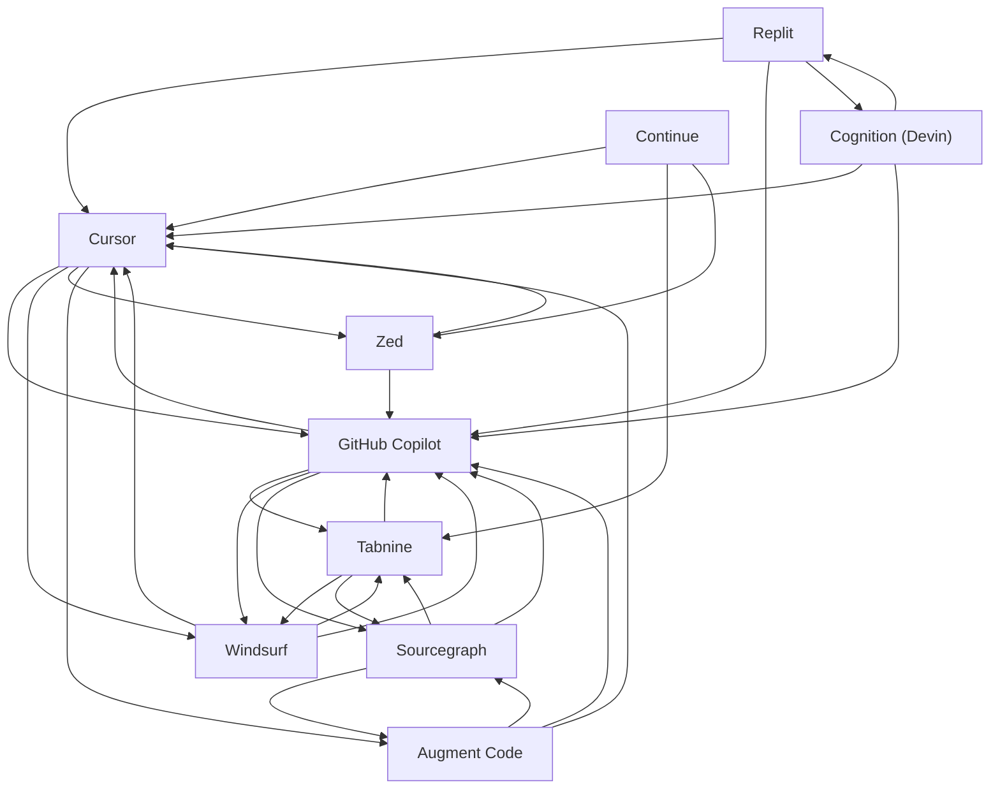

# AI coding assistants — Market Map

_10 companies · researched 2026-07-08 · source: mock_

> ⚠️ **Sample data** (offline mock mode) — illustrative only, verify before citing.

## Companies

| Company | Stage | Founded | One-liner |
| --- | --- | --- | --- |
| [[cursor|Cursor]] | growth | 2022 | AI-native code editor (a VS Code fork) built around an agentic pair-programmer. |
| [[github-copilot|GitHub Copilot]] | public | 2021 | The AI pair-programmer built into GitHub and popular IDEs, from GitHub/Microsoft. |
| [[windsurf|Windsurf]] | growth | 2021 | Agentic AI IDE (formerly Codeium) focused on autonomous multi-file coding flows. |
| [[tabnine|Tabnine]] | series B | 2018 | Enterprise AI code assistant emphasizing privacy and self-hosting. |
| [[replit|Replit]] | series B | 2016 | Browser-based dev environment with an AI Agent that builds and deploys apps. |
| [[sourcegraph|Sourcegraph]] | growth | 2013 | Code intelligence platform whose Cody assistant reasons over large codebases. |
| [[augment-code|Augment Code]] | series B | 2022 | Enterprise AI coding assistant tuned for large, complex codebases. |
| [[cognition-devin|Cognition (Devin)]] | growth | 2023 | Maker of Devin, an autonomous AI software engineer that completes tasks end-to-end. |
| [[zed|Zed]] | seed | 2021 | High-performance, collaborative code editor with built-in AI, from ex-Atom authors. |
| [[continue|Continue]] | seed | 2023 | Open-source AI code assistant you can point at any model, for VS Code and JetBrains. |

## Landscape summary

The AI coding assistants space is anchored by well-funded leaders such as Cursor, GitHub Copilot, Windsurf, which set the pace on capability and distribution. A wave of earlier-stage challengers — including Zed, Continue — competes on focused differentiation and specific customer segments. The main axes of competition are product depth, integration into existing developer and buyer workflows, and go-to-market motion. White space remains around underserved verticals and workflows the incumbents treat as secondary. (This summary is generated from sample data — verify before citing.)

## Relationship graph

