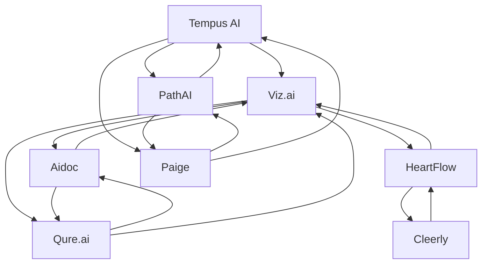

# AI healthcare diagnostics — Market Map

_8 companies · researched 2026-07-11 · source: mock_

> ⚠️ **Sample data** (offline mock mode) — illustrative only, verify before citing.

## Companies

| Company | Stage | Founded | Last round | One-liner | Verified |
| --- | --- | --- | --- | --- | --- |
| [[tempus-ai|Tempus AI]] | public | 2015 | IPO · Nasdaq · 2024-06 | Precision-medicine platform pairing clinical data with AI diagnostics. | 2026-07-11 |
| [[pathai|PathAI]] | series C | 2016 | Series C · ~$165M · 2021-05 | AI-powered pathology for diagnosis and drug development. | 2026-07-11 |
| [[viz-ai|Viz.ai]] | growth | 2016 | Series D · ~$100M · 2022-04 @ $1.2B | Care-coordination AI that detects strokes and routes patients in minutes. | 2026-07-11 |
| [[aidoc|Aidoc]] | growth | 2016 | Series D · ~$110M · 2022-06 | Always-on AI triage across radiology and care pathways. | 2026-07-11 |
| [[heartflow|HeartFlow]] | growth | 2007 | Round · ~$215M · 2023-04 | Turns coronary CT scans into 3D blood-flow analysis (FFR-CT). | 2026-07-11 |
| [[cleerly|Cleerly]] | series C | 2017 | Series C ext. · ~$106M · 2024-07 | AI coronary plaque analysis to predict heart attacks before symptoms. | 2026-07-11 |
| [[paige|Paige]] | series C | 2017 | Series C · ~$125M · 2021-01 | FDA-cleared AI pathology spun out of Memorial Sloan Kettering. | 2026-07-11 |
| [[qure-ai|Qure.ai]] | growth | 2016 | Series D · ~$65M · 2024-03 | AI for chest X-ray, TB and stroke screening across 90+ countries. | 2026-07-11 |

## Landscape summary

The AI healthcare diagnostics space is anchored by well-funded leaders such as Tempus AI, PathAI, Viz.ai, which set the pace on capability and distribution. A wave of earlier-stage challengers — including a long tail of earlier-stage entrants — competes on focused differentiation and specific customer segments. The main axes of competition are product depth, integration into existing developer and buyer workflows, and go-to-market motion. White space remains around underserved verticals and workflows the incumbents treat as secondary. (This summary is generated from sample data — verify before citing.)

## Relationship graph

