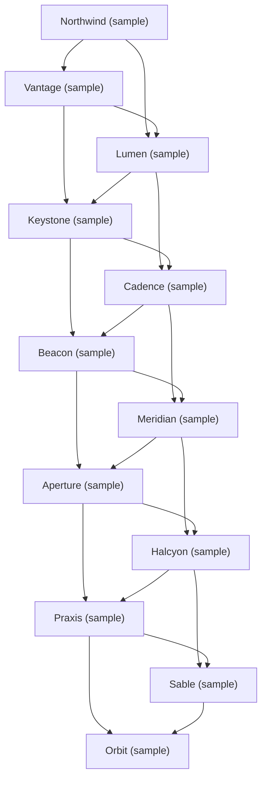

# AI healthcare diagnostics — Market Map

_12 companies · researched 2026-07-10 · source: mock_

> ⚠️ **Sample data** (offline mock mode) — illustrative only, verify before citing.

## Companies

| Company | Stage | Founded | Last round | One-liner | Verified |
| --- | --- | --- | --- | --- | --- |
| [[northwind-sample|Northwind (sample)]] | seed | — | — | Illustrative sample company #1 in the AI healthcare diagnostics space. | 2026-07-10 |
| [[vantage-sample|Vantage (sample)]] | series A | — | — | Illustrative sample company #2 in the AI healthcare diagnostics space. | 2026-07-10 |
| [[lumen-sample|Lumen (sample)]] | series B | — | — | Illustrative sample company #3 in the AI healthcare diagnostics space. | 2026-07-10 |
| [[keystone-sample|Keystone (sample)]] | growth | — | — | Illustrative sample company #4 in the AI healthcare diagnostics space. | 2026-07-10 |
| [[cadence-sample|Cadence (sample)]] | seed | — | — | Illustrative sample company #5 in the AI healthcare diagnostics space. | 2026-07-10 |
| [[beacon-sample|Beacon (sample)]] | series A | — | — | Illustrative sample company #6 in the AI healthcare diagnostics space. | 2026-07-10 |
| [[meridian-sample|Meridian (sample)]] | seed | — | — | Illustrative sample company #7 in the AI healthcare diagnostics space. | 2026-07-10 |
| [[aperture-sample|Aperture (sample)]] | series A | — | — | Illustrative sample company #8 in the AI healthcare diagnostics space. | 2026-07-10 |
| [[halcyon-sample|Halcyon (sample)]] | series B | — | — | Illustrative sample company #9 in the AI healthcare diagnostics space. | 2026-07-10 |
| [[praxis-sample|Praxis (sample)]] | growth | — | — | Illustrative sample company #10 in the AI healthcare diagnostics space. | 2026-07-10 |
| [[sable-sample|Sable (sample)]] | seed | — | — | Illustrative sample company #11 in the AI healthcare diagnostics space. | 2026-07-10 |
| [[orbit-sample|Orbit (sample)]] | series A | — | — | Illustrative sample company #12 in the AI healthcare diagnostics space. | 2026-07-10 |

## Landscape summary

The AI healthcare diagnostics space is anchored by well-funded leaders such as Keystone (sample), Praxis (sample), which set the pace on capability and distribution. A wave of earlier-stage challengers — including Northwind (sample), Vantage (sample), Cadence (sample) — competes on focused differentiation and specific customer segments. The main axes of competition are product depth, integration into existing developer and buyer workflows, and go-to-market motion. White space remains around underserved verticals and workflows the incumbents treat as secondary. (This summary is generated from sample data — verify before citing.)

## Relationship graph

