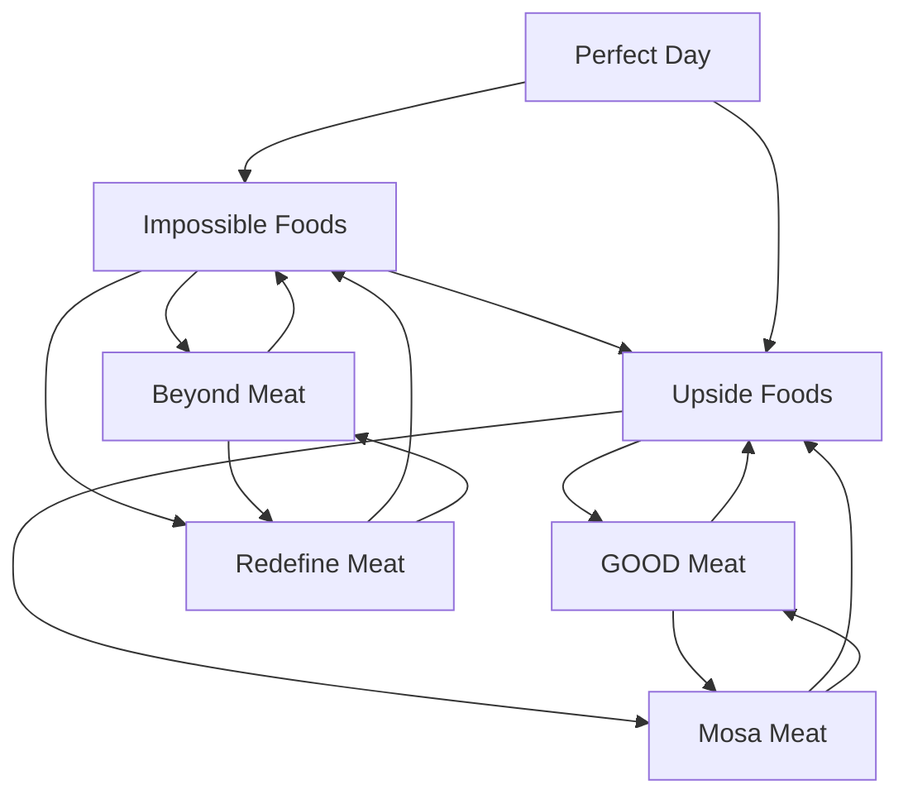

# Alternative proteins — Market Map

_7 companies · researched 2026-07-11 · source: mock_

> ⚠️ **Sample data** (offline mock mode) — illustrative only, verify before citing.

## Companies

| Company | Stage | Founded | Last round | One-liner | Verified |
| --- | --- | --- | --- | --- | --- |
| [[impossible-foods|Impossible Foods]] | growth | 2011 | Series H · ~$500M · 2021-11 | Heme-based plant meat sold across retail and foodservice. | 2026-07-11 |
| [[beyond-meat|Beyond Meat]] | public | 2009 | IPO · Nasdaq · 2019 | First plant-based meat company to IPO; retail brand under pressure. | 2026-07-11 |
| [[upside-foods|Upside Foods]] | series C | 2015 | Series C · ~$400M · 2022-04 @ $1B+ | Cultivated (lab-grown) chicken; first US FDA green-light. | 2026-07-11 |
| [[good-meat|GOOD Meat]] | growth | 2011 | Round · ~$170M (GOOD Meat) · 2021-05 | Eat Just's cultivated-meat arm — first in the world to sell it (Singapore). | 2026-07-11 |
| [[perfect-day|Perfect Day]] | growth | 2014 | Series D · ~$350M · 2021-09 @ $1.5B | Precision-fermented whey protein — dairy without cows. | 2026-07-11 |
| [[redefine-meat|Redefine Meat]] | series A | 2018 | Series A ext. · ~$135M · 2022-01 | 3D-printed plant-based whole cuts ('New Meat') sold via chefs. | 2026-07-11 |
| [[mosa-meat|Mosa Meat]] | series B | 2016 | Series B ext. · ~$40M · 2025-01 (reported) | Dutch cultivated-beef pioneer (made the first lab burger in 2013). | 2026-07-11 |

## Landscape summary

The Alternative proteins space is anchored by well-funded leaders such as Impossible Foods, Beyond Meat, Upside Foods, which set the pace on capability and distribution. A wave of earlier-stage challengers — including Redefine Meat — competes on focused differentiation and specific customer segments. The main axes of competition are product depth, integration into existing developer and buyer workflows, and go-to-market motion. White space remains around underserved verticals and workflows the incumbents treat as secondary. (This summary is generated from sample data — verify before citing.)

## Relationship graph

