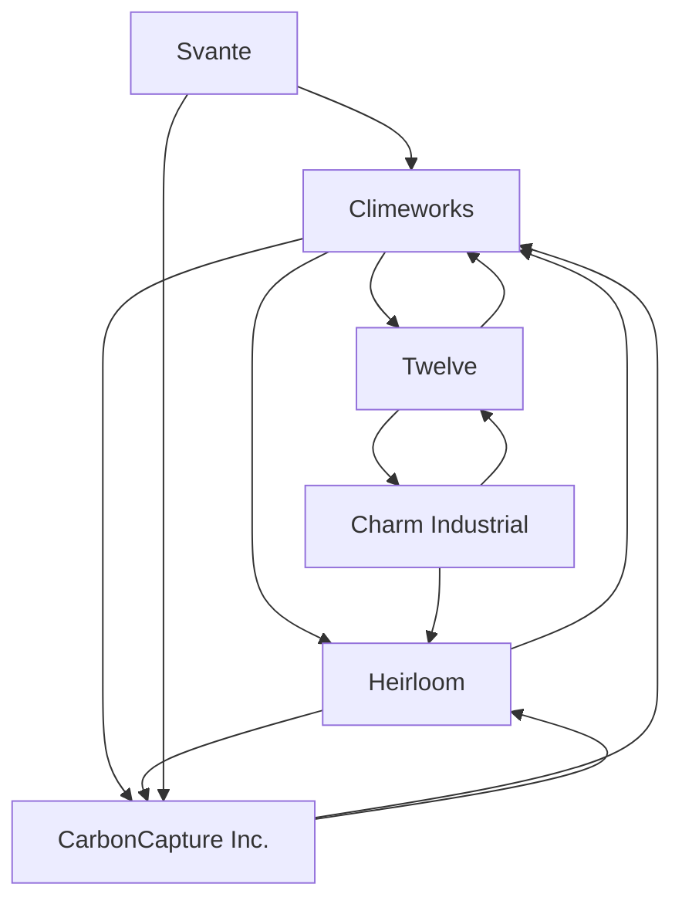

# Carbon capture — Market Map

_6 companies · researched 2026-07-11 · source: mock_

> ⚠️ **Sample data** (offline mock mode) — illustrative only, verify before citing.

## Companies

| Company | Stage | Founded | Last round | One-liner | Verified |
| --- | --- | --- | --- | --- | --- |
| [[climeworks|Climeworks]] | growth | 2009 | Equity round · ~$650M · 2022-04 | Swiss direct-air-capture pioneer operating Orca and Mammoth in Iceland. | 2026-07-11 |
| [[heirloom|Heirloom]] | series B | 2020 | Series B · ~$150M · 2024-01 | Limestone-based direct air capture with rapid mineralization cycles. | 2026-07-11 |
| [[charm-industrial|Charm Industrial]] | series B | 2018 | Series B · ~$100M · 2023-06 | Converts biomass to bio-oil and injects it underground for permanent storage. | 2026-07-11 |
| [[twelve|Twelve]] | series C | 2015 | Series C + project financing · ~$645M · 2024-09 | CO2-to-chemicals electrolysis, including e-jet fuel (E-Jet). | 2026-07-11 |
| [[carboncapture-inc|CarbonCapture Inc.]] | series A | 2019 | Series A ext. · ~$80M · 2023-11 | Modular, mass-manufactured DAC machines (Project Bison). | 2026-07-11 |
| [[svante|Svante]] | growth | 2007 | Series E · ~$318M · 2022-12 | Solid-sorbent filters capturing CO2 from industrial point sources. | 2026-07-11 |

## Landscape summary

The Carbon capture space is anchored by well-funded leaders such as Climeworks, Twelve, Svante, which set the pace on capability and distribution. A wave of earlier-stage challengers — including CarbonCapture Inc. — competes on focused differentiation and specific customer segments. The main axes of competition are product depth, integration into existing developer and buyer workflows, and go-to-market motion. White space remains around underserved verticals and workflows the incumbents treat as secondary. (This summary is generated from sample data — verify before citing.)

## Relationship graph

