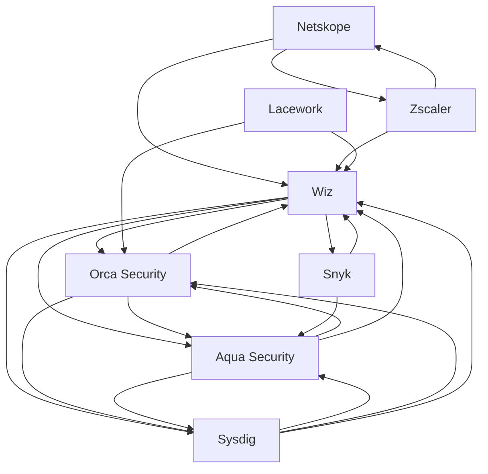

# Cloud security — Market Map

_8 companies · researched 2026-07-11 · source: mock_

> ⚠️ **Sample data** (offline mock mode) — illustrative only, verify before citing.

## Companies

| Company | Stage | Founded | Last round | One-liner | Verified |
| --- | --- | --- | --- | --- | --- |
| [[wiz|Wiz]] | acquired | 2020 | Google acquisition · ~$32B agreed · 2025 (reported) | Agentless cloud security platform (CNAPP) — fastest-scaling security startup ever. | 2026-07-11 |
| [[orca-security|Orca Security]] | growth | 2019 | Series C ext. · ~$550M · 2021-10 | Agentless cloud security via SideScanning of workloads. | 2026-07-11 |
| [[sysdig|Sysdig]] | growth | 2013 | Series G · ~$350M · 2021-12 | Runtime cloud security built on the open-source Falco project. | 2026-07-11 |
| [[aqua-security|Aqua Security]] | growth | 2015 | Series E ext. · ~$60M · 2023-12 | Container and cloud-native application protection pioneer. | 2026-07-11 |
| [[snyk|Snyk]] | growth | 2015 | Series G · ~$196M · 2022-12 | Developer-first security for code, dependencies, containers and IaC. | 2026-07-11 |
| [[netskope|Netskope]] | public | 2012 | IPO · Nasdaq · 2025-09 (reported) | SASE/SSE platform for securing web, cloud and private app access. | 2026-07-11 |
| [[zscaler|Zscaler]] | public | 2007 | IPO · Nasdaq · 2018 | Zero-trust exchange routing enterprise traffic through its security cloud. | 2026-07-11 |
| [[lacework|Lacework]] | acquired | 2015 | Fortinet acquisition · ~$150M · 2024 (reported) | Cloud security platform; acquired by Fortinet after a sharp markdown. | 2026-07-11 |

## Landscape summary

The Cloud security space is anchored by well-funded leaders such as Orca Security, Sysdig, Aqua Security, which set the pace on capability and distribution. A wave of earlier-stage challengers — including a long tail of earlier-stage entrants — competes on focused differentiation and specific customer segments. The main axes of competition are product depth, integration into existing developer and buyer workflows, and go-to-market motion. White space remains around underserved verticals and workflows the incumbents treat as secondary. (This summary is generated from sample data — verify before citing.)

## Relationship graph

