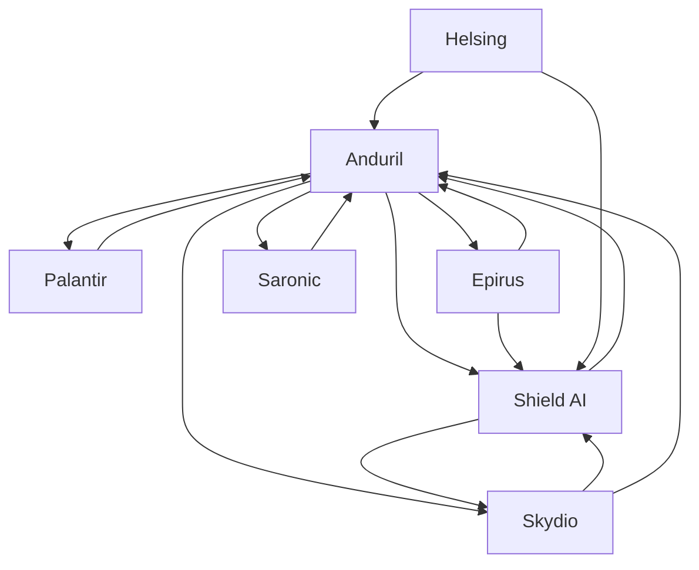

# Defense tech — Market Map

_7 companies · researched 2026-07-11 · source: mock_

> ⚠️ **Sample data** (offline mock mode) — illustrative only, verify before citing.

## Companies

| Company | Stage | Founded | Last round | One-liner | Verified |
| --- | --- | --- | --- | --- | --- |
| [[anduril|Anduril]] | growth | 2017 | Series G · ~$2.5B · 2025-06 @ $30.5B (reported) | Autonomous defense systems on the Lattice software backbone. | 2026-07-11 |
| [[shield-ai|Shield AI]] | growth | 2015 | Series F ext. · ~$240M · 2025-03 @ $5.3B (reported) | Hivemind AI pilot flying V-BAT drones and fighter jets autonomously. | 2026-07-11 |
| [[palantir|Palantir]] | public | 2003 | Direct listing · NYSE · 2020 | Data and AI platforms (Gotham, Foundry, AIP) for defense and industry. | 2026-07-11 |
| [[skydio|Skydio]] | growth | 2014 | Series E · ~$230M · 2023-02 @ $2.2B | Autonomous drones for defense, public safety and infrastructure. | 2026-07-11 |
| [[epirus|Epirus]] | growth | 2018 | Series D · ~$250M · 2025-03 (reported) | High-power microwave systems (Leonidas) that disable drone swarms. | 2026-07-11 |
| [[saronic|Saronic]] | series C | 2022 | Series C · ~$600M · 2025-02 @ $4B (reported) | Autonomous surface vessels for the US Navy. | 2026-07-11 |
| [[helsing|Helsing]] | growth | 2021 | Series D · ~€600M · 2025-06 @ €12B (reported) | European defense AI: software, strike drones, and air autonomy. | 2026-07-11 |

## Landscape summary

The Defense tech space is anchored by well-funded leaders such as Anduril, Shield AI, Palantir, which set the pace on capability and distribution. A wave of earlier-stage challengers — including a long tail of earlier-stage entrants — competes on focused differentiation and specific customer segments. The main axes of competition are product depth, integration into existing developer and buyer workflows, and go-to-market motion. White space remains around underserved verticals and workflows the incumbents treat as secondary. (This summary is generated from sample data — verify before citing.)

## Relationship graph

