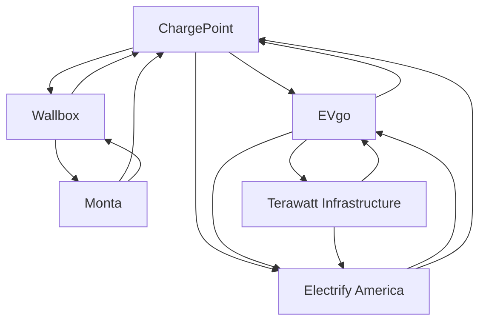

# EV charging infrastructure — Market Map

_6 companies · researched 2026-07-11 · source: mock_

> ⚠️ **Sample data** (offline mock mode) — illustrative only, verify before citing.

## Companies

| Company | Stage | Founded | Last round | One-liner | Verified |
| --- | --- | --- | --- | --- | --- |
| [[chargepoint|ChargePoint]] | public | 2007 | SPAC · NYSE · 2021 | Largest EV charging network operator in North America. | 2026-07-11 |
| [[evgo|EVgo]] | public | 2010 | SPAC · Nasdaq · 2021 | Public DC fast-charging network across the US. | 2026-07-11 |
| [[electrify-america|Electrify America]] | growth | 2016 | Siemens investment · ~$450M · 2022-06 | VW-founded national fast-charging network (Siemens-backed). | 2026-07-11 |
| [[wallbox|Wallbox]] | public | 2015 | SPAC · NYSE · 2021 | Smart home and commercial EV chargers, incl. bidirectional (Quasar). | 2026-07-11 |
| [[monta|Monta]] | series B | 2020 | Series B · ~€80M · 2023-01 | Software platform managing charge points for operators and businesses. | 2026-07-11 |
| [[terawatt-infrastructure|Terawatt Infrastructure]] | series A | 2021 | Series A · ~$100M+ · 2022-09 (plus infra capital) | Develops and operates charging hubs for electric truck fleets. | 2026-07-11 |

## Landscape summary

The EV charging infrastructure space is anchored by well-funded leaders such as ChargePoint, EVgo, Electrify America, which set the pace on capability and distribution. A wave of earlier-stage challengers — including Terawatt Infrastructure — competes on focused differentiation and specific customer segments. The main axes of competition are product depth, integration into existing developer and buyer workflows, and go-to-market motion. White space remains around underserved verticals and workflows the incumbents treat as secondary. (This summary is generated from sample data — verify before citing.)

## Relationship graph

