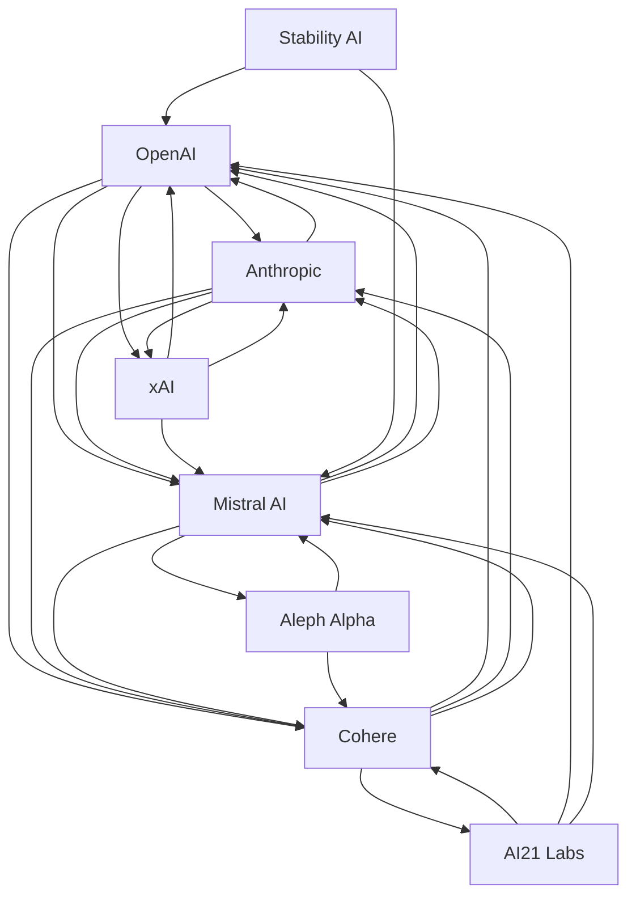

# Foundation models — Market Map

_8 companies · researched 2026-07-11 · source: mock_

> ⚠️ **Sample data** (offline mock mode) — illustrative only, verify before citing.

## Companies

| Company | Stage | Founded | Last round | One-liner | Verified |
| --- | --- | --- | --- | --- | --- |
| [[openai|OpenAI]] | growth | 2015 | Round · ~$40B · 2025-03 (reported) | Maker of GPT models and ChatGPT — the consumer front door to frontier AI. | 2026-07-11 |
| [[anthropic|Anthropic]] | growth | 2021 | Series E · ~$3.5B · 2025-03 (reported) | AI safety company behind the Claude model family. | 2026-07-11 |
| [[mistral-ai|Mistral AI]] | series B | 2023 | Series B · ~€600M · 2024-06 | French lab shipping open-weight and commercial frontier models. | 2026-07-11 |
| [[cohere|Cohere]] | growth | 2019 | Series D · ~$500M · 2024-07 | Enterprise-focused LLM provider with private-deployment emphasis. | 2026-07-11 |
| [[xai|xAI]] | growth | 2023 | Series C · ~$6B · 2024-12 (reported) | Elon Musk's AI lab building Grok, tied to the X platform. | 2026-07-11 |
| [[ai21-labs|AI21 Labs]] | series C | 2017 | Series C · ~$208M · 2023-11 | Israeli lab behind Jamba and task-specific enterprise models. | 2026-07-11 |
| [[aleph-alpha|Aleph Alpha]] | series B | 2019 | Series B · ~$500M · 2023-11 | German lab focused on sovereign, explainable AI for government and industry. | 2026-07-11 |
| [[stability-ai|Stability AI]] | series A | 2020 | Rescue round · ~$80M · 2024-06 (reported) | Open generative-media lab behind Stable Diffusion. | 2026-07-11 |

## Landscape summary

The Foundation models space is anchored by well-funded leaders such as OpenAI, Anthropic, Cohere, which set the pace on capability and distribution. A wave of earlier-stage challengers — including Stability AI — competes on focused differentiation and specific customer segments. The main axes of competition are product depth, integration into existing developer and buyer workflows, and go-to-market motion. White space remains around underserved verticals and workflows the incumbents treat as secondary. (This summary is generated from sample data — verify before citing.)

## Relationship graph

