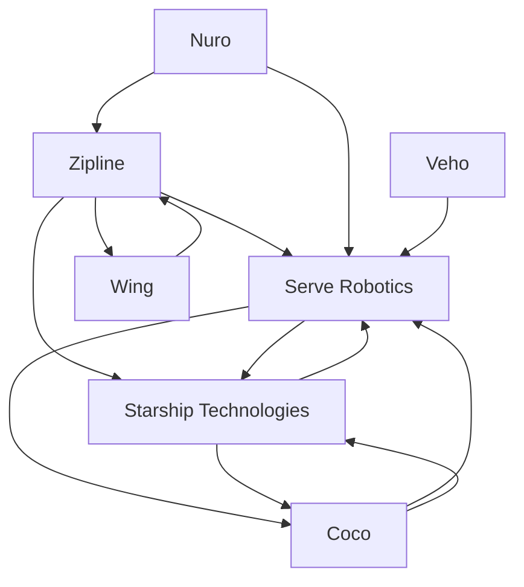

# Last-mile delivery — Market Map

_7 companies · researched 2026-07-11 · source: mock_

> ⚠️ **Sample data** (offline mock mode) — illustrative only, verify before citing.

## Companies

| Company | Stage | Founded | Last round | One-liner | Verified |
| --- | --- | --- | --- | --- | --- |
| [[zipline|Zipline]] | growth | 2014 | Series F · ~$330M · 2023-04 @ $4.2B | Autonomous drone logistics — from blood in Rwanda to Walmart home delivery. | 2026-07-11 |
| [[nuro|Nuro]] | growth | 2016 | Series E · ~$600M · 2021-11 (Tiger); licensing pivot 2024 | Autonomous delivery vehicles; pivoted to licensing its AV stack. | 2026-07-11 |
| [[serve-robotics|Serve Robotics]] | public | 2017 | Nasdaq listing · 2024 | Sidewalk delivery robots for Uber Eats and others; Nvidia-backed. | 2026-07-11 |
| [[starship-technologies|Starship Technologies]] | growth | 2014 | Round · ~$90M · 2024-01 | Pioneer of sidewalk robots — millions of campus deliveries. | 2026-07-11 |
| [[coco|Coco]] | series B | 2020 | Series B · ~$80M · 2025 (reported) | Remote-piloted delivery robots in LA, Chicago, Miami. | 2026-07-11 |
| [[wing|Wing]] | growth | 2012 | Alphabet X graduation · 2018 | Alphabet's drone-delivery arm partnered with Walmart and DoorDash. | 2026-07-11 |
| [[veho|Veho]] | series B | 2016 | Series B · ~$170M · 2022-02 @ $1.5B | Next-day e-commerce parcel delivery network built on crowdsourced drivers. | 2026-07-11 |

## Landscape summary

The Last-mile delivery space is anchored by well-funded leaders such as Zipline, Nuro, Serve Robotics, which set the pace on capability and distribution. A wave of earlier-stage challengers — including a long tail of earlier-stage entrants — competes on focused differentiation and specific customer segments. The main axes of competition are product depth, integration into existing developer and buyer workflows, and go-to-market motion. White space remains around underserved verticals and workflows the incumbents treat as secondary. (This summary is generated from sample data — verify before citing.)

## Relationship graph

