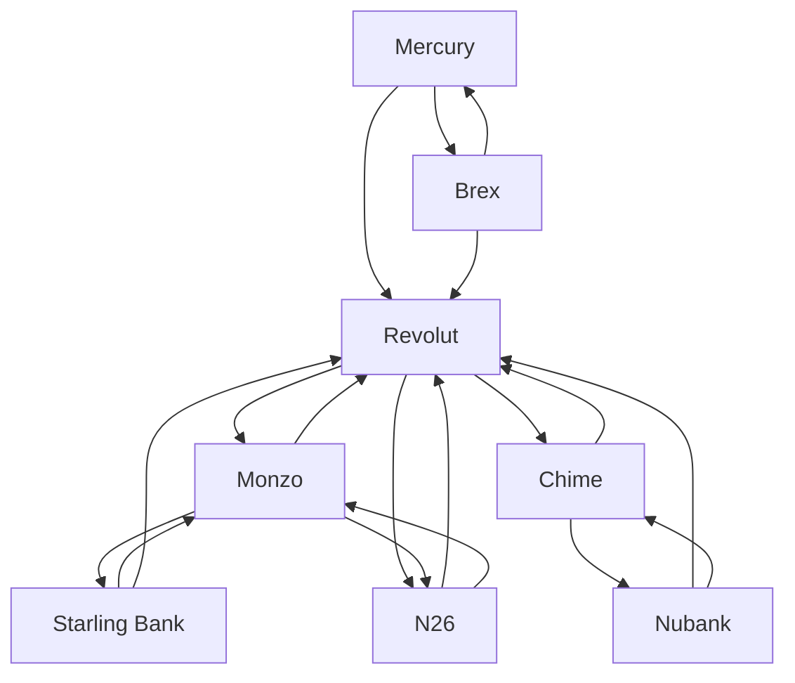

# Neobanks — Market Map

_8 companies · researched 2026-07-11 · source: mock_

> ⚠️ **Sample data** (offline mock mode) — illustrative only, verify before citing.

## Companies

| Company | Stage | Founded | Last round | One-liner | Verified |
| --- | --- | --- | --- | --- | --- |
| [[revolut|Revolut]] | growth | 2015 | Secondary @ ~$45B valuation · 2024-08 (reported) | London super-app: banking, FX, trading, crypto for 50M+ customers. | 2026-07-11 |
| [[chime|Chime]] | public | 2012 | IPO · Nasdaq · 2025-06 (reported) | Fee-free US consumer banking with early paycheck access. | 2026-07-11 |
| [[nubank|Nubank]] | public | 2013 | IPO · NYSE · 2021 | Latin America's biggest digital bank — 100M+ customers. | 2026-07-11 |
| [[monzo|Monzo]] | growth | 2015 | Round · ~$430M · 2024-03 | UK digital bank with 10M+ customers, now profitable. | 2026-07-11 |
| [[n26|N26]] | growth | 2013 | Series E · ~$900M · 2021-10 @ $9B | Berlin-based mobile bank operating across the EU. | 2026-07-11 |
| [[starling-bank|Starling Bank]] | growth | 2014 | Round · 2022 @ ~£2.5B | Profitable UK bank that also licenses its core (Engine) as SaaS. | 2026-07-11 |
| [[mercury|Mercury]] | series C | 2017 | Series C · ~$300M · 2025-03 @ $3.5B (reported) | Banking and finance stack for startups and SMBs. | 2026-07-11 |
| [[brex|Brex]] | growth | 2017 | Series D-2 · ~$300M · 2022-01 @ $12.3B | Corporate cards and spend management for startups and enterprises. | 2026-07-11 |

## Landscape summary

The Neobanks space is anchored by well-funded leaders such as Revolut, Chime, Nubank, which set the pace on capability and distribution. A wave of earlier-stage challengers — including a long tail of earlier-stage entrants — competes on focused differentiation and specific customer segments. The main axes of competition are product depth, integration into existing developer and buyer workflows, and go-to-market motion. White space remains around underserved verticals and workflows the incumbents treat as secondary. (This summary is generated from sample data — verify before citing.)

## Relationship graph

