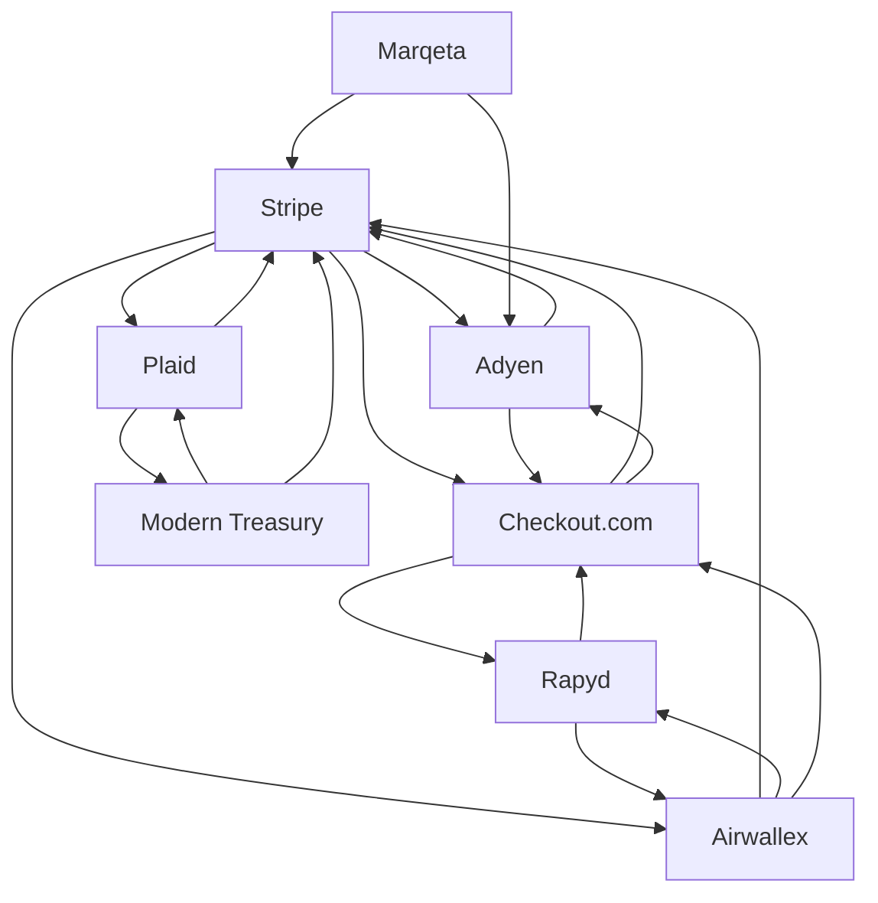

# Payments infrastructure — Market Map

_8 companies · researched 2026-07-11 · source: mock_

> ⚠️ **Sample data** (offline mock mode) — illustrative only, verify before citing.

## Companies

| Company | Stage | Founded | Last round | One-liner | Verified |
| --- | --- | --- | --- | --- | --- |
| [[stripe|Stripe]] | growth | 2010 | Series I / tender · ~$6.5B · 2023-03 @ $50B (reported) | Developer-first payments infrastructure powering millions of businesses. | 2026-07-11 |
| [[adyen|Adyen]] | public | 2006 | IPO · Euronext · 2018 | Single-platform global payments processor for large merchants. | 2026-07-11 |
| [[checkout-com|Checkout.com]] | growth | 2012 | Series D · ~$1B · 2022-01 @ $40B, later marked down (reported) | Enterprise payment processing across 150+ currencies and emerging markets. | 2026-07-11 |
| [[plaid|Plaid]] | growth | 2013 | Round · ~$575M · 2025-04 (reported) | Bank-data connectivity layer linking consumer accounts to fintech apps. | 2026-07-11 |
| [[marqeta|Marqeta]] | public | 2010 | IPO · Nasdaq · 2021 | Modern card-issuing API platform. | 2026-07-11 |
| [[airwallex|Airwallex]] | growth | 2015 | Series F · ~$300M · 2025-05 @ $6.2B (reported) | Cross-border business accounts, FX and payments infrastructure. | 2026-07-11 |
| [[rapyd|Rapyd]] | growth | 2016 | Series E · ~$300M · 2021-08 | Fintech-as-a-service: local payment rails in 100+ countries via one API. | 2026-07-11 |
| [[modern-treasury|Modern Treasury]] | series C | 2018 | Series C · ~$50M · 2022-01 | Payment-operations and ledgering layer for money movement at scale. | 2026-07-11 |

## Landscape summary

The Payments infrastructure space is anchored by well-funded leaders such as Stripe, Adyen, Checkout.com, which set the pace on capability and distribution. A wave of earlier-stage challengers — including a long tail of earlier-stage entrants — competes on focused differentiation and specific customer segments. The main axes of competition are product depth, integration into existing developer and buyer workflows, and go-to-market motion. White space remains around underserved verticals and workflows the incumbents treat as secondary. (This summary is generated from sample data — verify before citing.)

## Relationship graph

