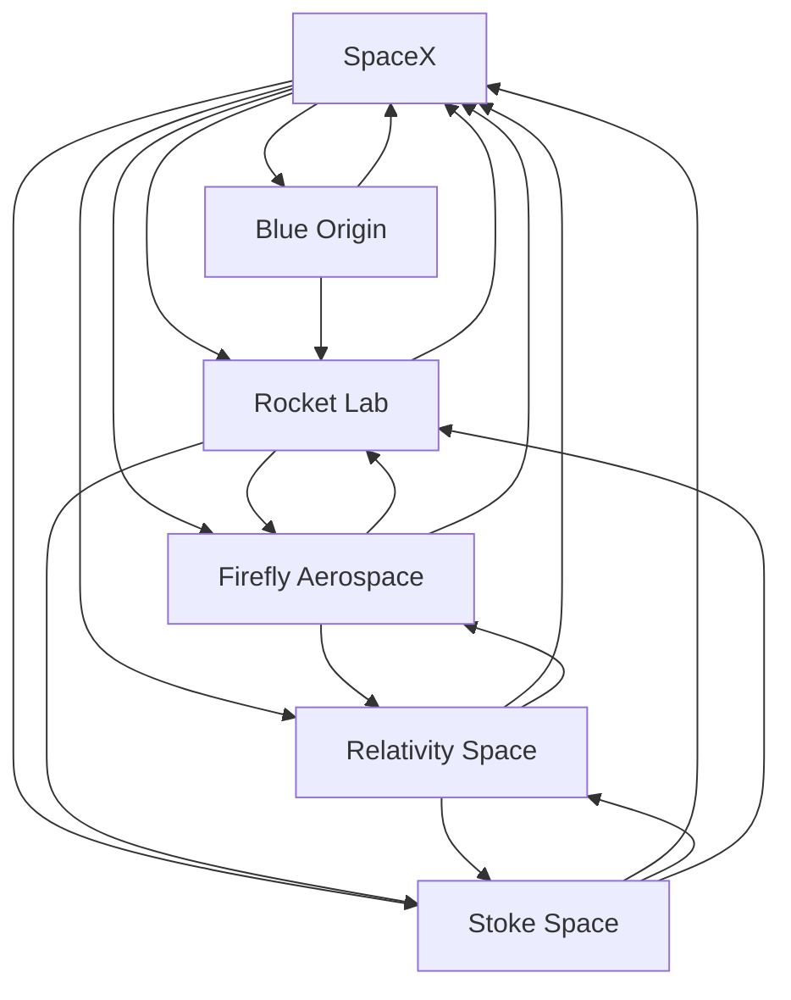

# Space launch — Market Map

_6 companies · researched 2026-07-11 · source: mock_

> ⚠️ **Sample data** (offline mock mode) — illustrative only, verify before citing.

## Companies

| Company | Stage | Founded | Last round | One-liner | Verified |
| --- | --- | --- | --- | --- | --- |
| [[spacex|SpaceX]] | growth | 2002 | Secondary @ ~$350B valuation · 2024-12 (reported) | Reusable rockets (Falcon), Starship, and the Starlink constellation. | 2026-07-11 |
| [[rocket-lab|Rocket Lab]] | public | 2006 | SPAC · Nasdaq · 2021 | Small-launch leader (Electron) scaling up to Neutron. | 2026-07-11 |
| [[blue-origin|Blue Origin]] | bootstrapped | 2000 | New Glenn first flight · 2025-01 | Jeff Bezos' space company: New Glenn, New Shepard, Blue Moon lander. | 2026-07-11 |
| [[relativity-space|Relativity Space]] | growth | 2015 | Series E · ~$650M · 2021-06 (Fidelity); Eric Schmidt took control 2025 (reported) | 3D-printed rockets; pivoted fully to the reusable Terran R. | 2026-07-11 |
| [[firefly-aerospace|Firefly Aerospace]] | public | 2017 | IPO · Nasdaq · 2025-08 (reported) | Alpha rockets and the Blue Ghost lunar lander (landed 2025). | 2026-07-11 |
| [[stoke-space|Stoke Space]] | series C | 2019 | Series C · ~$260M · 2025-01 (reported) | Fully-reusable two-stage rocket (Nova) with novel regenerative heat shield. | 2026-07-11 |

## Landscape summary

The Space launch space is anchored by well-funded leaders such as SpaceX, Rocket Lab, Relativity Space, which set the pace on capability and distribution. A wave of earlier-stage challengers — including a long tail of earlier-stage entrants — competes on focused differentiation and specific customer segments. The main axes of competition are product depth, integration into existing developer and buyer workflows, and go-to-market motion. White space remains around underserved verticals and workflows the incumbents treat as secondary. (This summary is generated from sample data — verify before citing.)

## Relationship graph

