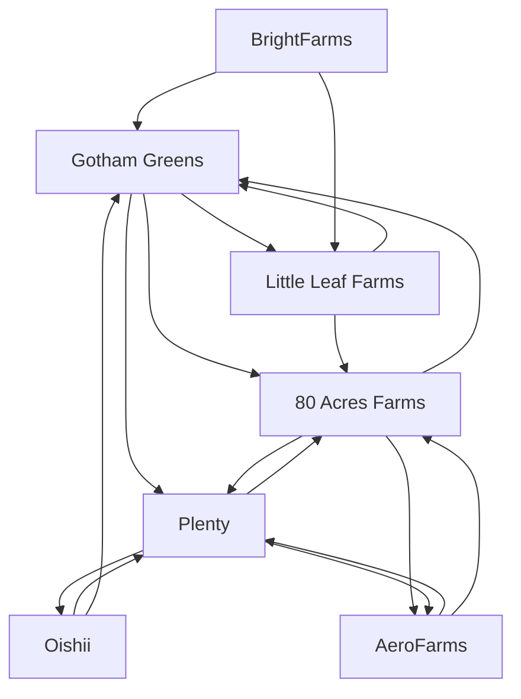

# Vertical farming — Market Map

_7 companies · researched 2026-07-11 · source: mock_

> ⚠️ **Sample data** (offline mock mode) — illustrative only, verify before citing.

## Companies

| Company | Stage | Founded | Last round | One-liner | Verified |
| --- | --- | --- | --- | --- | --- |
| [[gotham-greens|Gotham Greens]] | growth | 2009 | Series E · ~$310M · 2022-09 | Greenhouse network growing leafy greens near US cities. | 2026-07-11 |
| [[oishii|Oishii]] | series B | 2016 | Series B · ~$134M · 2024-02 | Premium vertical-farmed strawberries (the “Omakase berry”). | 2026-07-11 |
| [[little-leaf-farms|Little Leaf Farms]] | growth | 2015 | Debt+equity · ~$300M · 2022-08 | Largest US greenhouse lettuce brand by retail share. | 2026-07-11 |
| [[80-acres-farms|80 Acres Farms]] | series B | 2015 | Series B ext. · ~$160M · 2021-08 | Fully-automated indoor vertical farms in the US Midwest. | 2026-07-11 |
| [[plenty|Plenty]] | unknown | 2014 | Chapter 11 filing · 2025 (reported); prior: $400M Series E 2022 (Walmart) | High-profile vertical-farming unicorn; filed for Chapter 11 in 2025. | 2026-07-11 |
| [[aerofarms|AeroFarms]] | unknown | 2004 | Emerged from Ch.11 · 2023 (reported) | Aeroponic pioneer; restructured through Chapter 11 in 2023 and refocused on microgreens. | 2026-07-11 |
| [[brightfarms|BrightFarms]] | acquired | 2010 | Cox Enterprises majority acquisition · 2021 | Greenhouse salads operator acquired by Cox Enterprises. | 2026-07-11 |

## Landscape summary

The Vertical farming space is anchored by well-funded leaders such as Gotham Greens, Little Leaf Farms, which set the pace on capability and distribution. A wave of earlier-stage challengers — including a long tail of earlier-stage entrants — competes on focused differentiation and specific customer segments. The main axes of competition are product depth, integration into existing developer and buyer workflows, and go-to-market motion. White space remains around underserved verticals and workflows the incumbents treat as secondary. (This summary is generated from sample data — verify before citing.)

## Relationship graph

